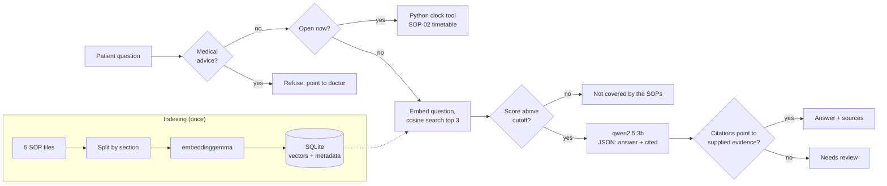

# Clinic Procedure Assistant

**It answers from the clinic's own rules, and says so when it can't.**

A local retrieval-augmented (RAG) assistant that answers patient questions about clinic
procedures (registration, opening hours, fees, appointments) using only the clinic's SOP
documents. Every answer cites the SOP section it came from. Questions the SOPs do not cover
get an honest "not covered", and medical questions are refused. Everything runs on a laptop
through Ollama, so no question leaves the machine.


> The clinic (Klinik Kesihatan Taman Mawar) and its SOPs are fictional and were written for
> this project. This is a portfolio project, not a medical or official information service.

## Why

Patients ask the registration counter the same questions every day, and the answers already
sit in the clinic's standard operating procedures. Nobody reads a 5-page SOP in a waiting
room, and a general chatbot will happily invent a plausible answer, even though every clinic
runs on its own rules. This assistant is built to do the opposite: answer only from the
clinic's documents, show the evidence, and admit when the documents are silent.

It is a companion to my AI-powered Hospital Queue project ([other projects](https://github.com/amirulfahmiii920-beep)): that one tells
patients how long they will wait, this one tells them what to do.

## What it does

| Feature | How |
|---|---|
| Answers with citations | Retrieves the most relevant SOP sections and the model must cite them, e.g. *SOP-01 §2* |
| Says "not covered" | If no section scores above a relevance cutoff, or the model reports the evidence does not answer, it says so instead of guessing |
| Refuses medical advice | A scope guard blocks questions about medicines, doses, diagnosis or treatment before any model call |
| Understands follow-ups | "What if I forgot it?" is searched together with the previous question |
| Checks opening hours in code | "Is the clinic open now?" is answered by a Python function from the SOP-02 timetable, not by the model |
| Flags unsupported answers | A citation check marks any answer that cites evidence it was not given as *Needs review* |
| Runs locally | Ollama with `qwen2.5:3b` for answers and `embeddinggemma` for search |

## How it works



1. **Indexing.** Each SOP section (`## 2. Documents to bring`) becomes one chunk. Sections are
   short and self-contained, so every rule stays whole and every answer can cite an exact
   section. Chunks are embedded with `embeddinggemma` (using its query/document task prefixes)
   and stored in SQLite with the document name, section, title and version.
2. **Retrieval.** The question is embedded with the same model and compared by cosine
   similarity against every section. The top 3 above `MIN_SCORE = 0.45` become numbered evidence.
3. **Generation.** `qwen2.5:3b` (temperature 0) must reply as JSON matching a Pydantic schema:
   `{"answer": str, "cited": [int]}`, or the sentinel `NOT_IN_SOP`.
4. **Validation.** Three layers: the reply must parse, match the schema, and every cited
   number must refer to evidence that was actually supplied. Otherwise the answer is shown as
   *Needs review*, not as a verified answer.

## Results

Ten test questions in [`tests/questions.csv`](tests/questions.csv): five answered by the SOPs,
two paraphrases, one follow-up, one topic the SOPs do not cover and one medical question.

| Check | Result |
|---|---|
| Retrieval: expected section in the top 3 (or nothing above the cutoff for out-of-scope questions) | **10 / 10** ([details](tests/retrieval_results.md)) |
| Full assistant, automatic check (status + expected section cited) | **9 / 10** ([details](tests/answer_results_qwen2.5-3b.md)) |
| Full assistant, read by hand against the SOPs | **8 / 10 fully correct, 0 wrong** ([review](tests/manual_review.md)) |

The one automatic failure (Q03) is the citation check doing its job: the model added a
sentence that is not in the SOP and cited evidence it had not been given, so the answer was
flagged instead of shown as verified.

### Choosing the model

I compared two local models with the same prompt, retrieval and questions on a
GTX 1650 (4 GB VRAM):

| | qwen2.5:1.5b | qwen2.5:3b |
|---|---|---|
| Fully correct (by hand) | 7 / 10 | **8 / 10** |
| Wrong answers a patient could act on | 2 | **0** |
| Average time per answer | 5.9 s | 7.3 s |

`qwen2.5:3b` is the default. The smaller model misread the Friday timetable and told a
patient who was 20 minutes late that they would become a walk-in (that rule applies after 30
minutes). Retrieval found the right section in both cases; the errors came from the model
rewriting correct evidence. **A cited answer is not automatically a correct answer**, which
is why the project keeps a hand-checked review alongside the automatic tests.

## Screenshots

| | |
|---|---|
|  |  |
| Follow-up: "it" is resolved to the MyKad from the previous question | A question the SOPs do not cover gets an honest answer |
|  |  |
| Medical advice is refused before any model call | Retrieval test: 10 / 10 |

## Run it

Requirements: Python 3.11 and [Ollama](https://ollama.com/download).

```bash
ollama pull qwen2.5:3b
ollama pull embeddinggemma

python -m venv .venv
.venv\Scripts\activate            # macOS/Linux: source .venv/bin/activate
pip install -r requirements.txt

python src/ingest.py              # build the SOP index
python app.py                     # open http://127.0.0.1:7860
```

Run the tests:

```bash
python tests/eval_retrieval.py
python tests/eval_answers.py                       # uses qwen2.5:3b
CHAT_MODEL=qwen2.5:1.5b python tests/eval_answers.py   # compare another model (bash syntax)
```

## Project structure

```
data/sop/              5 fictional SOP documents (the knowledge base)
src/config.py          models, top-k, relevance cutoff
src/ollama_client.py   minimal Ollama HTTP client (standard library only)
src/ingest.py          split SOPs by section, embed, store in SQLite
src/retrieve.py        cosine search with cutoff; refuses an index built with another model
src/guards.py          medical-advice scope guard
src/clinic_hours.py    deterministic "open now?" tool (Malaysia time, UTC+8)
src/answer.py          the pipeline: guard -> tool -> retrieve -> generate -> validate
app.py                 Gradio interface
tests/                 questions, evaluation scripts, results, manual review
```

## Limitations

- The SOPs are fictional and short (5 documents, 25 sections). Retrieval was tuned on 10
  questions; the relevance cutoff sits close to some scores (a supported question scored
  0.457 and an unsupported one 0.399 against a 0.45 cutoff), so more test questions are
  needed before trusting it on a larger corpus.
- English only. Malaysian patients would also ask in Bahasa Melayu; small local models are
  weaker there and this has not been tested.
- The medical-advice guard is keyword based. It catches the obvious cases, not every phrasing.
- The opening-hours tool does not know about public holidays and says so in its answer.
- Even with citations, answers can be incomplete (one test answer left out the medication
  record book). Patients should confirm important details at the counter.

## Built with

Python, Ollama (`qwen2.5:3b`, `embeddinggemma`), SQLite, Pydantic, Gradio.
Built after the GenAI Associate course (OpenAI API, Gradio, RAG and agent modules), extending
the course's RAG lab into a complete, tested application.
